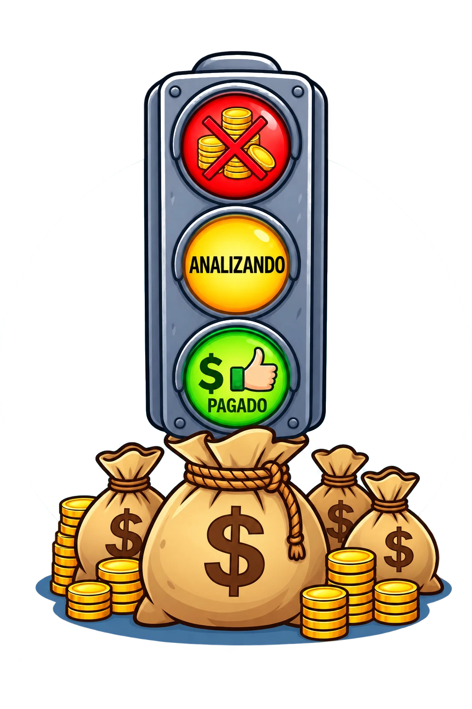

# Semáforo de Cartera Predial para QGIS



Herramienta unificada para cargar una Geodatabase catastral, los registros R1/R2 y el reporte de cartera; cruzarlos automáticamente por código predial; y crear una sola capa con semáforo. No modifica los archivos originales.

## Flujo de trabajo

1. Abre **Vector → Semáforo de Cartera → Semáforo de Cartera Predial**.
2. Carga la GDB comprimida (`.gdb.zip`/`.zip`) o selecciona una carpeta `.gdb`.
3. Carga los archivos R1, R2 y cartera. Selecciona la hoja correspondiente cuando un archivo tenga varias.
4. El plugin carga exclusivamente `R_TERRENO`, `U_TERRENO`, `R_TERRENO_INFORMAL` y `U_TERRENO_INFORMAL`; ignora construcciones, unidades, sectores y las demás capas de la GDB.
5. Pulsa **🚦 Crear capa unificada y semáforo**.

Los campos de código se detectan por sus nombres y por las coincidencias reales. Los botones **🛠 Código…** permiten corregir manualmente la llave si una plantilla utiliza nombres diferentes.

El selector **Capa unificada resultante** no muestra capas individuales de origen. Después del procesamiento contiene únicamente la capa final donde se realizó la unión espacial y alfanumérica. La consolidación de los terrenos disponibles es automática y obligatoria.

## Regla del semáforo

- 🔴 **EN DEUDA:** el código predial aparece en el reporte de cartera, incluso si su saldo es cero. Conserva la vigencia (años desde/hasta) que trae la cartera.
- 🟢 **PAZ Y SALVO:** el código existe en las capas espaciales y no aparece en cartera. Como no tiene vigencia en el reporte, se le asigna la **vigencia actual del ejercicio** (el año del sistema al crear la capa) y sus datos de propietario, identificación, dirección y avalúo se toman de R1. Así aparece, con información completa, junto a los deudores en los análisis por vigencia.
- Los registros con **código vacío se omiten** de la capa resultante.
- Los códigos no vacíos que contienen caracteres inválidos o no tienen 20/30 dígitos se separan como **códigos ilegibles** y se incluyen en un reporte de inconsistencias.

Los deudores que están en cartera pero no existen en las capas de terreno se conservan en la misma tabla con `PRED_LOCALIZADO = NO` y geometría vacía. De esta manera el reporte queda completo, aunque esos registros no puedan dibujarse en el mapa.

## Resultado unificado

La capa temporal **`Semáforo cartera — GDB-R1-R2`** contiene:

- Campos espaciales con prefijo `GDB_`, incluido `GDB_VEREDA_NOMBRE` (nombre de la vereda tomado de la capa `R_VEREDA` de la GDB al cruzar por `GDB_VEREDA_CODIGO`).
- Información registral con prefijos `R1_` y `R2_`.
- Datos originales del reporte con prefijo `CARTERA_`.
- Resumen de deuda en `CART_ESTADO`, `CART_SALDO`, `CART_OBLIG`, `CART_VIG_DES`, `CART_VIG_HAS`, `CART_PERIODO` y `CART_DETALLE`.
- Clasificación territorial en `PRED_AMBITO`, `PRED_FORMALIDAD`, `PRED_CLASE` y `PRED_LOCALIZADO`.

`PRED_CLASE` distingue rural formal, urbano formal, rural informal y urbano informal.

## Funciones de la pantalla única

- **Filtros rápidos:** deuda, paz y salvo, registros sin geometría y cada clase territorial.
- **Botones del semáforo:** muestran los totales de todos, en deuda, paz y salvo, códigos ilegibles y sin geometría. Los botones de clasificación filtran la tabla y seleccionan los polígonos correspondientes en el mapa; el de códigos ilegibles genera su reporte Excel.
- **Colores en la tabla:** las filas en deuda aparecen con fondo rojo suave y las filas a paz y salvo con fondo verde suave.
- **Filtro de texto:** busca códigos, propietarios, valores o cualquier atributo visible.
- **🗄 Consulta SQL:** ejecuta expresiones de QGIS sobre la capa y selecciona las coincidencias en una sola lectura.
- **📊 Exportar resultado:** utiliza la unión ya calculada y crea un Excel con las hojas `Resumen ejecutivo`, `Análisis financiero`, `Balance financiero`, `Todos los registros`, `Deudores`, `Paz y salvo` y `Códigos ilegibles`, sin reprocesar los insumos. La hoja `Paz y salvo` refleja los predios al día con todos sus atributos, igual que `Deudores` con los morosos. En `Deudores` y `Paz y salvo` cada fila completa queda coloreada igual que en `Balance financiero` (rojo suave para deuda, verde suave para paz y salvo), no solo la celda de estado.
- **Resumen financiero automático:** calcula cartera pendiente por recaudar a partir de `SALDO`, predios deudores, paz y salvo, promedio de deuda, localizados y no localizados. Incluye gráficos por clase predial y las diez veredas con mayor cartera.
- **Balance filtrable:** contiene una fila por predio y filtros de Excel para código y nombre de vereda, manzana, ámbito, formalidad, clase, estrato, destino económico, estado, vigencia, propietario, identificación, dirección, avalúo, localización y capa de origen.
- **Análisis financiero:** resume automáticamente cantidades y saldos por estado, clase predial, vereda (con nombre), manzana, estrato, destino económico y vigencia cada vez que se exporta, separando deudores y paz y salvo.

> **Nota financiera:** el insumo de cartera contiene el campo `SALDO`, no pagos recibidos. Por eso el tablero presenta **cartera pendiente por recaudar** y no recaudo efectivamente cobrado.

- **🔍 Ver capa completa:** ajusta el mapa a la extensión de los cuatro grupos de polígonos.
- **➕ Añadir capas al proyecto:** añade las capas originales de la GDB cuando se necesitan por separado.

## Rendimiento

La unión utiliza índices en memoria y una ruta rápida para las llaves prediales conocidas. La tabla es virtual y solo representa las celdas visibles. La lectura, la unión y la exportación muestran progreso, permiten cancelar y procesan eventos periódicamente para mantener QGIS receptivo. Al crear la capa temporal, los atributos se convierten a tipos compatibles y los textos consolidados no tienen el antiguo límite de 254 caracteres. El plugin cuenta los registros y las geometrías realmente almacenados; si un lote falla, reconstruye la capa entidad por entidad antes de informar un error.

## Habilitación por municipio

El aplicativo está habilitado únicamente para **Morelia (Caquetá), código catastral 18479**. Antes de cruzar y de exportar, valida que los predios pertenezcan a ese municipio usando los cinco primeros dígitos del número predial (departamento + municipio). Si la Geodatabase corresponde a otro municipio, avisa al cargarla y detiene tanto la creación de la capa unificada como la exportación.

El código habilitado no se guarda en texto plano: se conserva como un hash SHA‑256 con sal (`LICENSED_MUNICIPALITY_HASH` en `gdb_join_core.py`), de modo que no basta con buscar y reemplazar un número para cambiarlo. Es un control de alcance territorial y un disuasivo; como todo complemento de QGIS se distribuye en Python, no constituye un cifrado irreversible del código. Para habilitar otro municipio hay que recalcular el hash con la sal vigente.

## Instalación

1. En QGIS abre **Complementos → Administrar e instalar complementos → Instalar a partir de ZIP**.
2. Selecciona `semaforo_cartera_qgis.zip`.
3. Activa **Semáforo de Cartera Predial**.

Si reemplazas otra compilación con el mismo número de versión, desinstálala y reinicia QGIS antes de instalar el ZIP nuevo.

## Recomendaciones de datos

- Conserva el código predial completo como texto para no perder ceros ni precisión.
- Revisa el total de deudores localizados y sin geometría después del cruce.
- Los códigos duplicados de una misma fuente se consolidan sin duplicar la geometría.

## Pruebas

```powershell
python -m unittest discover -s semaforo_cartera_qgis/tests -v
```

Las reglas de negocio se prueban sin requerir QGIS. La interfaz admite QGIS 3.22 o posterior.

## Licencia

GNU General Public License v2 o posterior. Copyright 2026 Jose Orlando Castillo Ospina.
